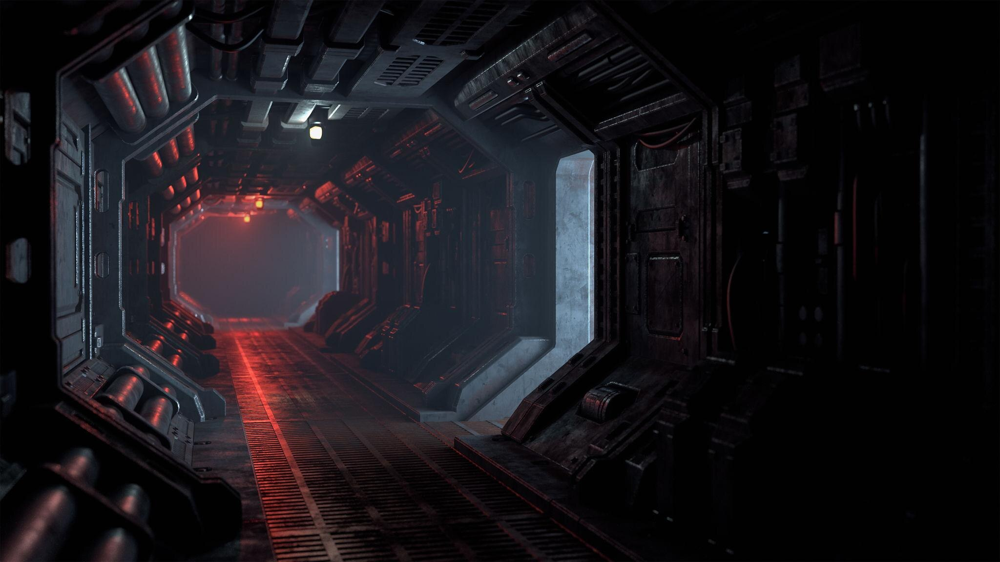

# PROJECT ECHO-9 — Visual Overhaul, etap V1: cinematic service corridor

**Status: APPROVED DIRECTION / REFERENCES READY / VISUAL ACCEPTANCE PENDING**

Zatwierdzenie właściciela: Adrian zaakceptował 16.11.2026 kierunek **Visual Overhaul**, priorytet jakości filmowej ponad rozmiarem pliku, z zachowaniem proceduralnego WebGPU/WGSL na pierwszą próbę. To **nowe, ograniczone zadanie na jedną scenę**. Zatwierdzenie tego kierunku **nie oznacza akceptacji renderów** ani automatycznej zgody na przebudowanie pozostałych sektorów.

Powiązania: [Issue #1](https://github.com/adixoncode/project-echo-9/issues/1) · [AGENTS.md](https://github.com/adixoncode/project-echo-9/blob/main/AGENTS.md) · [Visual review](https://github.com/adixoncode/project-echo-9/blob/main/docs/qa/VISUAL-REVIEW.md).

## Dlaczego powstaje ta karta

Aktualny widok z buildu 7164bff jest czysty, geometryczny, z mocnym cyjanowym akcentem i płasko wyglądającymi materiałami. Adrian odrzucił go jako **zbyt ubogi artystycznie** względem przesłanych w rozmowie referencji: mroczne, monumentalne, opuszczone wnętrza stacji rodem z kina science fiction, z zużytym metalem, rurami/kablami, kierunkowymi światłami, cieniami, kurzem, atmosferą i wiarygodną skalą.

Niezależny recenzent w Issue #1 oceniał ujęcia bez wskazanego **docelowego obrazu referencyjnego**. Dlatego ocena „minor” oznaczała brak dużych technicznych defektów w dostarczonych renderach — **nie** zgodność z oczekiwaną jakością artystyczną. W tym zadaniu ta luka ma zostać naprawiona.

## Materiały referencyjne — GOTOWE W REPOZYTORIUM

Adrian dostarczył cztery kadry. Są zapisane w `docs/references/` jako **dokumentacja wizualna, nigdy zasoby runtime**. Wszystkie oryginalne rozdzielczości zachowano; dla Git zastosowano kompresję JPEG. Zobacz [opis i instrukcję użycia](https://github.com/adixoncode/project-echo-9/blob/main/docs/references/README.md).

### Wzorzec obowiązkowy dla pierwszej iteracji — korytarz

[**RED CORRIDOR — główna referencja artystyczna**](https://github.com/adixoncode/project-echo-9/blob/main/docs/references/target-red-corridor.jpg)

### Pozostałe kadry kontekstu

- [TARGET — obserwatorium, samotna postać i planeta](https://github.com/adixoncode/project-echo-9/blob/main/docs/references/target-observatory.jpg)
- [TARGET — hangar / panorama planetarna / zużyte materiały](https://github.com/adixoncode/project-echo-9/blob/main/docs/references/target-panorama-hangar.jpg)
- [CURRENT — odrzucony wygląd ECHO-9 z buildu 7164bff](https://github.com/adixoncode/project-echo-9/blob/main/docs/references/current-echo9.jpg)

**Bramka wejścia odblokowana**: Codex ma przeczytać i obejrzeć rzeczywisty plik `docs/references/target-red-corridor.jpg` oraz porównać z `current-echo9.jpg`, a następnie przed zmianami zaproponować konkretny plan do akceptacji Adriana. Wzorce to cele nastroju, kompozycji i jakości, a nie materiały do kopiowania w aplikacji.

## Zakres pierwszej iteracji — TYLKO jeden „hero shot” korytarza serwisowego

Zachowaj istniejący projekt, sektor obserwatorium/hangaru, sterowanie, trasę, diagnostykę i czytelne moduły; zakres zmian ogranicz do jakości wizualnej **jednego korytarza i jego ustalonej kamery**. Bez dodawania gry, zadań, walki i rozbudowy całego świata.

Cel:
- Monumentalna, wiarygodna **architektura industrialna**, warstwowe profile/krawędzie, instalacje, rury, kable, śluza i głębia korytarza; nie pusta, powtarzalna geometria.
- **Materiały proceduralne** z kontrolowaną chropowatością, nierównościami, smugami, zużyciem i różnymi typami powierzchni; bez „plastikowej” płaskości i agresywnego jednolitego cyjanu.
- **Filmowy kontrast**: oszczędne czerwone światła awaryjne, zimne światło uzupełniające, silne cienie, subtelny poświat, ciemne ale czytelne partie obrazu.
- **Głębia atmosferyczna**: pył, delikatna mgła, rozproszenie w wiązkach światła, odpowiednia hierarchia planów.
- Przekonująca **kompozycja 16:9**: czytelny punkt skupienia, rytm konstrukcji, oś ucieczki i skala. HUD nie zasłania głównego kadru; dostarcz również render „clean” bez interfejsu.
- Utrzymanie poprawnej geometrii, braku przenikania i spójnego zachowania kamery; brak flickeru i nadmiernego szumu.

**Nie tłumacz słabego obrazu samym brakiem GPU.** Diagnostyczny SwiftShader spowalnia lub uniemożliwia ocenę ruchu, ale statyczne oświetlenie, kompozycję, materiały i sylwetkę sceny da się recenzować.

## Technologia i kompromisy

- Na ten etap **A**: natywne WebGPU/WGSL, proceduralna geometria i materiały, bez bibliotek/silników 3D i bez zewnętrznych runtime modeli/tekstur; jeden offline `index.html`.
- **Jakość artystyczna > płynność > samodzielność pliku > minimalny rozmiar**. 100 KB to cel eksperymentalny, nie twardy limit; raportuj wzrost rozmiaru, nie kasuj jakości tylko po to, by utrzymać 68 KB.
- Dozwolone optymalizacje shaderów, geometrii, materiałów, światła i postprocesu. **Nie rozszerzaj samodzielnie na wariant B** (modele/tekstury przygotowane zewnętrznie, silnik/biblioteki) — jeżeli A wyraźnie nie osiąga referencji, zatrzymaj się i opisz kompromis, prosząc Adriana o decyzję.
- Nie ukrywaj ograniczeń GPU/SwiftShader. Bramka 60 FPS na referencyjnym sprzęcie pozostaje BLOCKED i należy do powiązanego Issue #1.

## Proces i kryteria odbioru

1. Przeczytaj `AGENTS.md`, obecny Issue #1 i tę kartę, zapoznaj się z **rzeczywistym obrazem referencyjnym**. Przed implementacją przedstaw krótki plan i zaczekaj na akceptację Adriana.
2. Wytwórz pojedynczy porównywalny kadr korytarza w rozdzielczości **1920×1080**, przy stałym seede i położeniu kamery, w wersji z HUD oraz „clean”.
3. Zrób zestawienie **referencja obok aktualnego renderu** i analizę różnic: kompozycja, architektura, materiały, oświetlenie, atmosfera, szczegółowość i opowiadanie historii. Krytyk wizualny musi otrzymać **obraz referencyjny i wynik**, ale bez kodu ani uzasadnienia autora.
4. Iteruj w sposób udokumentowany. Maksymalnie **3 wyraźne iteracje wizualne** przed przedstawieniem kandydatów Adrianowi; nie rozbudowuj reszty świata w tle.
5. **Bramka STOP/GO**: przedstaw render(y) i konkretne odstępstwa. **Tylko Adrian** zatwierdza kierunek („TAK, o to chodzi”). Bez jego zgody nie zaczynaj overhaul obserwatorium/hangaru i nie opisuj wyniku jako artystycznie ukończonego.
6. Zachowaj sprawność istniejącej aplikacji i wcześniejszych sektorów, deterministykę oraz brak zewnętrznych assetów runtime. Dla każdej iteracji uruchom build, `RunAllTests`, smoke browser tam gdzie dostępny; zapisz PASS/FAIL/BLOCKED.
7. Na zakończenie zatwierdzonego zakresu: aktualizacja dokumentacji, `AGENTS.md` i karty, commit na `main`, `git push` zgodnie z zasadami właściciela, ale **nie zamykaj Issue #1** bez brakujących testów sprzętowych B/C.

**Bramka wizualna nie przechodzi tylko dlatego, że „nie ma usterek większych niż minor”.** Bez zgodności nastroju i jakości z referencją + bez wyraźnej akceptacji Adriana: **ART DIRECTION = NOT ACCEPTED**.

## Raport końcowy

Krótko: zmiany, link do renderów i porównania z referencją, wyniki build/RunAllTests/smoke, ograniczenia i kompromisy, stan akceptacji artystycznej oraz GPU, odchylenia od karty; na końcu lista zmian w `AGENTS.md` i kartach (albo „brak”).
