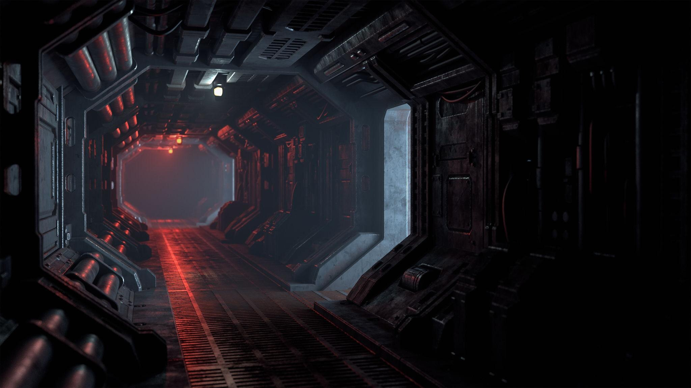

# PROJECT ECHO-9 — Visual Overhaul, etap V1: cinematic service corridor

**Status: ITERATION 2 APPROVED / IMPLEMENTATION PENDING / ART DIRECTION NOT ACCEPTED**

Zatwierdzenie właściciela: Adrian zaakceptował 16.11.2026 kierunek **Visual Overhaul**, priorytet jakości filmowej ponad rozmiarem pliku, z zachowaniem proceduralnego WebGPU/WGSL na pierwszą próbę. To **nowe, ograniczone zadanie na jedną scenę**. Zatwierdzenie tego kierunku **nie oznacza akceptacji renderów** ani automatycznej zgody na przebudowanie pozostałych sektorów.

Powiązania: [Issue #1](https://github.com/adixoncode/project-echo-9/issues/1) · [AGENTS.md](https://github.com/adixoncode/project-echo-9/blob/main/AGENTS.md) · [Visual review](https://github.com/adixoncode/project-echo-9/blob/main/docs/qa/VISUAL-REVIEW.md).

## Iteracja 2 — ZATWIERDZONA przez Adriana, 17.11.2026

**Zakres zatwierdzenia:** tylko druga iteracja artystyczna korytarza serwisowego „Cinematic Lighting & HDR Overhaul”, z zachowaniem natywnego WebGPU/WGSL, proceduralnych materiałów i geometrii, offline pojedynczego HTML i braku zewnętrznych assetów/engine. Adrian zatwierdził przedstawiony w rozmowie plan: HDR + relighting + głębia/atmosfera + poprawa odbić. To nie jest akceptacja pierwszego renderu ani zgoda na trzecią iterację lub overhaul pozostałych sektorów.

**Cel:** zbliżyć rzeczywisty render korytarza do `docs/references/target-red-corridor.jpg`. Bazą jest `308807a` i `docs/qa/overhaul-v1/iteration-1/after-clean.png`. Zachować seed 15515657, czas 12s, kamerę [-2.35,1.72,27.5] → [-13.5,1.78,61], FOV 64°, High, DPR1, 4×MSAA, obraz 1920×1080 (clean/HUD).

### Priorytety implementacji

1. **P0 — wspólny liniowy HDR i końcowe wywołanie tone mappingu.** Zdiagnozować ścieżkę `src/corridor-shaders.js` / `src/corridor-renderer.js`: aktualnie `tone(color*1.35)` jest w `corridorFragment`, a fog tonemapped i alpha blended osobno w przestrzeni wyświetlania. Zbudować spójny fragment toru `rgba16float`: oświetlenie i odbicia → scattering/atmosfera → bloom → ekspozycja/filmic tone mapping/gamma **raz na końcu**. Uniknąć podwójnego tone mappingu/gamma, utraty energii HDR i wypalonej czerni. Wspólne zmiany renderera muszą zachować wygląd innych sektorów; w razie konieczności wydzielić tor korytarza/kompozycję per materiał, z prawidłową głębokością. Żadnej sztucznej podmiany widoku przy progu kamery.
2. **P0 — art-directed relighting zamiast globalnego podbicia jasności.** Chłodne jasne światło/kontra czytelnie wycina najbliższą/środkową masywną ramę i konkretne rury; lokalne czerwone źródło w dalekim planie buduje cel wzrokowy, oświetla ścianki i rzuca czerwone refleksy na podłogę. Zachować głębokie cienie poza akcentami. Lampy, ich kolory i oświetlone powierzchnie muszą być przestrzennie spójne. Sprawdzić realne cienie od konkretnych profili i rur.
3. **P1 — związana ze światłami atmosfera.** Zastąpić jednolity czerwony nalot/ciemność depth-aware scatteringiem (przybliżone wolumetryczne światło, transmittance, promienie/mgła), którego energia i kolor wynikają z tych samych świateł. Separacja planów: czytelny pierwszy, środkowy i zamglony daleki. Ograniczyć koszt, banding, halo na granicy geometrii i temporalny shimmer.
4. **P1 — fizycznie wiarygodne refleksy i materiały.** W istniejących materiałach proceduralnych i sondzie GGX uzyskać szerokie, zróżnicowane zgodne z położeniem źródeł światła refleksy (szczególnie czerwona podłoga i chłodne krawędzie), nie jasne, równomierne paski. Sprawdzić roughness/metalness, nierówności kierunkowe i normalne. Nie przykrywać problemu przypadkowym szumem.
5. **P1 — subtelny bloom z HDR**, wyłącznie dla istotnie jasnych obszarów, z kontrolą progu i bez rozmywania całego kadru.
6. **P2 — tylko celowane poprawki geometrii** tam, gdzie przeszkadzają światłu/wiarygodności. Nie dodawać masowo rur, paneli ani innych sektorów.

### Wymogi i punkty kontrolne

- Przed codingiem przeczytać `AGENTS.md`, Issue #1/#2, referencję, rzeczywiste rendery pierwszej iteracji i niezależną recenzję; przedstawić krótki plan wykonania w ramach **już zatwierdzonego zakresu**. Nie rozszerzać scope bez nowej decyzji Adriana.
- Prowadzić etapowo: baza (ta sama kamera) → HDR+tonemap → relighting → atmosfera/refleksy/bloom. Zachować rzeczywiste diagnostyczne obrazy/ablation jako dowód, ale przekazać niezależnemu recenzentowi tylko referencję i rzeczywisty final render/HUD bez kodu lub argumentów autora.
- Odbiór przede wszystkim wizualny: czy w miniaturze widać trzy plany; czy chłodna rama jest czytelna, a czerwony daleki cel skupia wzrok; czy czerwone źródła rzeczywiście oświetlają i odbijają się w powierzchniach; czy cienie są identyfikowalne; czy materiały i mgła nie robią plastikowego/wypranego obrazu. Nie traktować metryki jasności jako samodzielnego kryterium. Pomiar bazowy: 91,77% pikseli ciemniejszych niż 24/255 vs 60,51% w referencji; poprawa ma iść w stronę wzorca, nie przez jednolite rozjaśnienie całego obrazu.
- **Regresje:** zachować zasoby, RNG, ruch i kolizje obserwatorium/hangaru, wszystkie 6 ujęć i trasę 60s, pojedynczy offline HTML. Sprawdzić ujęcia pozostałych sektorów; jeśli wspólny renderer powoduje regresje, naprawić je w ramach zatwierdzonego scope lub opisać BLOCKED, bez ukrywania różnicy. Bez nowych runtime assetów, bibliotek/silników.
- **Testy/dowody:** `npm run build`, `npm run RunAllTests` (wszystkie PASS), browser smoke, fallback; 1920×1080 clean/HUD, obok siebie `target-red-corridor.jpg`, screenshot porównawczy przed/po, niezależna recenzja reference-relative, opis błędów i rozmiar raw/gzip; przechowywać pod `docs/qa/overhaul-v1/iteration-2/`.
- Brak sprzętowego GPU nadal oznacza `BLOCKED` dla sprzętowych 60 FPS i testów temporalnych. Nie wnioskować o wydajności z SwiftShadera.
- Na zakończenie Iteracji 2: uaktualnić AGENTS, QA i Issue #2, wypchnąć commit na `main`, krótki raport co/testy/odstępstwa/ryzyka/zmiany AGENTS i kart. **STOP po niezależnej recenzji i prezentacji jednego kandydata Adrianowi.** `ART DIRECTION: NOT ACCEPTED` dopóki sam Adrian nie zaakceptuje. Trzecia iteracja, obserwatorium i hangar nie są autoryzowane.

### Techniczna inspiracja (bez kopiowania obrazu lub runtime assetów)

`adixoncode/abyssal-garden` → `source/src/main.js` i `source/src/shaders.js`: `rgba16float` scena, half-res volumetric rays, wielopoziomowy bloom, końcowa ekspozycja + tone mapping. To punkt odniesienia dla *architektury efektów*, nie wymaganie kopiowania kodu. Jeśli adaptujesz fragmenty obcego kodu, sprawdź i zachowaj licencję/atrybucję.

---

## Raport pierwszej iteracji — 17 listopada 2026

Wykonano **wyłącznie pierwszą iterację korytarza**, zgodnie z zatwierdzeniem właściciela. Kod i dowody są na `main`: [308807a](https://github.com/adixoncode/project-echo-9/commit/308807a1cadbe58a4dfc825f9c92a266fb369f14).

**Wynik artystyczny: poziom referencji NIE został osiągnięty. ART DIRECTION = NOT ACCEPTED. Praca ZATRZYMANA; druga iteracja nie została rozpoczęta.** Niezależny GPT-6 Astra porównał rzeczywistą referencję z renderem czystym, HUD i stanem bazowym z tej samej kamery, bez kodu i uzasadnienia autora. Potwierdził wyraźną poprawę architektury oraz industrialnego kierunku, ale wskazał krytyczne niedoświetlenie/hierarchię światła oraz duże braki w wizualnej czytelności cieni, odbić i kompozycji. Po recenzji nie wprowadzono korekt artystycznych. Ta ocena dotyczy obrazu i nie jest tłumaczona brakiem GPU.

### Rzeczywiste obrazy i raport

- [Porównanie: referencja / kandydat](https://github.com/adixoncode/project-echo-9/blob/main/docs/qa/overhaul-v1/iteration-1/comparison-reference.png)
- [Porównanie: przed / po, identyczna kamera](https://github.com/adixoncode/project-echo-9/blob/main/docs/qa/overhaul-v1/iteration-1/comparison-baseline.png)
- [Czysty render 1920×1080](https://github.com/adixoncode/project-echo-9/blob/main/docs/qa/overhaul-v1/iteration-1/after-clean.png) · [render z HUD](https://github.com/adixoncode/project-echo-9/blob/main/docs/qa/overhaul-v1/iteration-1/after-hud.png)
- [Pełne wyniki](https://github.com/adixoncode/project-echo-9/blob/main/docs/qa/overhaul-v1/iteration-1/RESULTS.md) · [niezależna recenzja](https://github.com/adixoncode/project-echo-9/blob/main/docs/qa/overhaul-v1/iteration-1/INDEPENDENT-REVIEW.md)

Kamera: pozycja[-2.35,1.72,27.5], cel[-13.5,1.78,61], pionowy FOV64°, seed15515657, czas12s, High, DPR1, 4×MSAA, render1920×1080. Obrazy są rzeczywistym wynikiem WebGPU, bez retuszu; w środowisku użyto jawnego odczytu GPU przez CPU i SwiftShadera. Referencja nie jest assetem runtime.

| Sprawdzenie | Rzeczywisty wynik |
| --- | --- |
| Build / `npm run RunAllTests` | **PASS**, 15/15, zachowane wcześniejsze testy |
| Smoke przeglądarkowy | **PASS**, 17/17, w tym sterowanie, pointer lock, menu, presety, audio API i plik offline |
| Brak API / adaptera / błąd urządzenia | **PASS**, 3/3 |
| Geometria/materiały obserwatorium i hangaru, RNG świata | **PASS**, identyczne hashe względem bazowego kodu |
| Regresje obrazów innych sektorów | Trzy ujęcia obserwatorium i jedno hangaru identyczne pikselowo. Drugie ujęcie hangaru różni się tylko widocznym wejściem do nowego korytarza: 55 739 pikseli(2,688%), obszar[1520,409,1795,643]; reszta obrazu identyczna. |
| Oryginalna trasa i poszycie wyjścia | **PASS**, zachowane punkty trasy; dodatkowy test promieniowy zamknięcia poszycia |
| Zgodność artystyczna z referencją | **FAIL** według niezależnego recenzenta; akceptacja właściciela nadal oczekiwana |
| Sprzętowe GPU / 60 FPS / ocena temporalna | **BLOCKED**, brak zweryfikowanego sprzętu referencyjnego; brak nowej deklaracji wydajności |
| Dokumentacja, AGENTS.md, commit main i push | **PASS** |

HTML: **105 761 B raw /34 927 B gzip**, wzrost względem bazy o37 703 /10 581 B. SHA256: `aeb80e7100df3c58c4e916426285f6140c3b2e49882edc85972f43ffd7277db6`. Cel100KB pozostaje dodatkowy, nie został wymuszony kosztem jakości.

Zaimplementowano grube fazowane profile, zakrzywione rury/obejmy, zagłębione kraty, asymetryczne wnęki, dwie buforowane mapy cieni2048² oraz GGX z lokalnymi odbiciami z sześciu rzeczywistych widoków HDR korytarza(128², 8 poziomów, filtrowanie GGX, korekcja paralaksy pudełkiem pomieszczenia). Nie zmieniono geometrii ani materiałów pozostałych sektorów. Nowy korytarz jest renderowany z każdej kamery, bez podmiany przy przekroczeniu progu.

Diagnostyczne wyłączenie cieni zmienia7,167% pikseli; wyłączenie odbić otoczenia95,253%. Mechanizmy wpływają na obraz, ale recenzent uznał ich widoczny rezultat za niewystarczający. Kandydat ma91,77% pikseli poniżej luminancji ekranowej24/255, referencja60,51% — opisowa miara brakującej hierarchii jasnych partii, nie punktacja artystyczna.

Kontrola regresji wykryła szczelinę w poszyciu przy rozszerzonym wyjściu. Naprawiono wyłącznie geometrię połączenia przed recenzją; dowód błędu i test zachowano. Materiały, światło i ekspozycja nie były poprawiane po recenzji. Kompromisy: jedna buforowana sonda odbić zamiast wielokrotnego GI, atmosfera jako przybliżone pochłanianie wewnątrz bryły korytarza po tonemappingu, mikrodetale drugorzędne.

**STOP / oczekiwanie na ocenę Adriana.** Nie rozpoczęto iteracji2 ani przebudowy obserwatorium/hangaru. Issue #1 pozostaje otwarte z niezaliczonymi bramkami sprzętowymi i temporalnymi. Zaktualizowano `AGENTS.md`, dokumentację QA i tę kartę; negatywna recenzja została zachowana w całości.

---

## Dlaczego powstaje ta karta

Aktualny widok z buildu 7164bff jest czysty, geometryczny, z mocnym cyjanowym akcentem i płasko wyglądającymi materiałami. Adrian odrzucił go jako **zbyt ubogi artystycznie** względem przesłanych w rozmowie referencji: mroczne, monumentalne, opuszczone wnętrza stacji rodem z kina science fiction, z zużytym metalem, rurami/kablami, kierunkowymi światłami, cieniami, kurzem, atmosferą i wiarygodną skalą.

Niezależny recenzent w Issue #1 oceniał ujęcia bez wskazanego **docelowego obrazu referencyjnego**. Dlatego ocena „minor” oznaczała brak dużych technicznych defektów w dostarczonych renderach — **nie** zgodność z oczekiwaną jakością artystyczną. W tym zadaniu ta luka ma zostać naprawiona.

## Materiały referencyjne — GOTOWE W REPOZYTORIUM

Adrian dostarczył cztery kadry. Są zapisane w `docs/references/` jako **dokumentacja wizualna, nigdy zasoby runtime**. Wszystkie oryginalne rozdzielczości zachowano; dla Git zastosowano kompresję JPEG. Zobacz [opis i instrukcję użycia](https://github.com/adixoncode/project-echo-9/blob/main/docs/references/README.md).

### Wzorzec obowiązkowy dla pierwszej iteracji — korytarz

[**RED CORRIDOR — główna referencja artystyczna**](https://github.com/adixoncode/project-echo-9/blob/main/docs/references/target-red-corridor.jpg)

### Pozostałe kadry kontekstu

- [TARGET — obserwatorium, samotna postać i planeta](https://github.com/adixoncode/project-echo-9/blob/main/docs/references/target-observatory.jpg)
- [TARGET — hangar / panorama planetarna / zużyte materiały](https://github.com/adixoncode/project-echo-9/blob/main/docs/references/target-panorama-hangar.jpg)
- [CURRENT — odrzucony wygląd ECHO-9 z buildu 7164bff](https://github.com/adixoncode/project-echo-9/blob/main/docs/references/current-echo9.jpg)

**Bramka wejścia odblokowana**: Codex ma przeczytać i obejrzeć rzeczywisty plik `docs/references/target-red-corridor.jpg` oraz porównać z `current-echo9.jpg`, a następnie przed zmianami zaproponować konkretny plan do akceptacji Adriana. Wzorce to cele nastroju, kompozycji i jakości, a nie materiały do kopiowania w aplikacji.

## Zakres pierwszej iteracji — TYLKO jeden „hero shot” korytarza serwisowego

Zachowaj istniejący projekt, sektor obserwatorium/hangaru, sterowanie, trasę, diagnostykę i czytelne moduły; zakres zmian ogranicz do jakości wizualnej **jednego korytarza i jego ustalonej kamery**. Bez dodawania gry, zadań, walki i rozbudowy całego świata.

Cel:
- Monumentalna, wiarygodna **architektura industrialna**, warstwowe profile/krawędzie, instalacje, rury, kable, śluza i głębia korytarza; nie pusta, powtarzalna geometria.
- **Materiały proceduralne** z kontrolowaną chropowatością, nierównościami, smugami, zużyciem i różnymi typami powierzchni; bez „plastikowej” płaskości i agresywnego jednolitego cyjanu.
- **Filmowy kontrast**: oszczędne czerwone światła awaryjne, zimne światło uzupełniające, silne cienie, subtelny poświat, ciemne ale czytelne partie obrazu.
- **Głębia atmosferyczna**: pył, delikatna mgła, rozproszenie w wiązkach światła, odpowiednia hierarchia planów.
- Przekonująca **kompozycja 16:9**: czytelny punkt skupienia, rytm konstrukcji, oś ucieczki i skala. HUD nie zasłania głównego kadru; dostarcz również render „clean” bez interfejsu.
- Utrzymanie poprawnej geometrii, braku przenikania i spójnego zachowania kamery; brak flickeru i nadmiernego szumu.

**Nie tłumacz słabego obrazu samym brakiem GPU.** Diagnostyczny SwiftShader spowalnia lub uniemożliwia ocenę ruchu, ale statyczne oświetlenie, kompozycję, materiały i sylwetkę sceny da się recenzować.

## Technologia i kompromisy

- Na ten etap **A**: natywne WebGPU/WGSL, proceduralna geometria i materiały, bez bibliotek/silników 3D i bez zewnętrznych runtime modeli/tekstur; jeden offline `index.html`.
- **Jakość artystyczna > płynność > samodzielność pliku > minimalny rozmiar**. 100 KB to cel eksperymentalny, nie twardy limit; raportuj wzrost rozmiaru, nie kasuj jakości tylko po to, by utrzymać 68 KB.
- Dozwolone optymalizacje shaderów, geometrii, materiałów, światła i postprocesu. **Nie rozszerzaj samodzielnie na wariant B** (modele/tekstury przygotowane zewnętrznie, silnik/biblioteki) — jeżeli A wyraźnie nie osiąga referencji, zatrzymaj się i opisz kompromis, prosząc Adriana o decyzję.
- Nie ukrywaj ograniczeń GPU/SwiftShader. Bramka 60 FPS na referencyjnym sprzęcie pozostaje BLOCKED i należy do powiązanego Issue #1.

## Proces i kryteria odbioru

1. Przeczytaj `AGENTS.md`, obecny Issue #1 i tę kartę, zapoznaj się z **rzeczywistym obrazem referencyjnym**. Przed implementacją przedstaw krótki plan i zaczekaj na akceptację Adriana.
2. Wytwórz pojedynczy porównywalny kadr korytarza w rozdzielczości **1920×1080**, przy stałym seede i położeniu kamery, w wersji z HUD oraz „clean”.
3. Zrób zestawienie **referencja obok aktualnego renderu** i analizę różnic: kompozycja, architektura, materiały, oświetlenie, atmosfera, szczegółowość i opowiadanie historii. Krytyk wizualny musi otrzymać **obraz referencyjny i wynik**, ale bez kodu ani uzasadnienia autora.
4. Iteruj w sposób udokumentowany. Maksymalnie **3 wyraźne iteracje wizualne** przed przedstawieniem kandydatów Adrianowi; nie rozbudowuj reszty świata w tle.
5. **Bramka STOP/GO**: przedstaw render(y) i konkretne odstępstwa. **Tylko Adrian** zatwierdza kierunek („TAK, o to chodzi”). Bez jego zgody nie zaczynaj overhaul obserwatorium/hangaru i nie opisuj wyniku jako artystycznie ukończonego.
6. Zachowaj sprawność istniejącej aplikacji i wcześniejszych sektorów, deterministykę oraz brak zewnętrznych assetów runtime. Dla każdej iteracji uruchom build, `RunAllTests`, smoke browser tam gdzie dostępny; zapisz PASS/FAIL/BLOCKED.
7. Na zakończenie zatwierdzonego zakresu: aktualizacja dokumentacji, `AGENTS.md` i karty, commit na `main`, `git push` zgodnie z zasadami właściciela, ale **nie zamykaj Issue #1** bez brakujących testów sprzętowych B/C.

**Bramka wizualna nie przechodzi tylko dlatego, że „nie ma usterek większych niż minor”.** Bez zgodności nastroju i jakości z referencją + bez wyraźnej akceptacji Adriana: **ART DIRECTION = NOT ACCEPTED**.

## Raport końcowy

Krótko: zmiany, link do renderów i porównania z referencją, wyniki build/RunAllTests/smoke, ograniczenia i kompromisy, stan akceptacji artystycznej oraz GPU, odchylenia od karty; na końcu lista zmian w `AGENTS.md` i kartach (albo „brak”).
